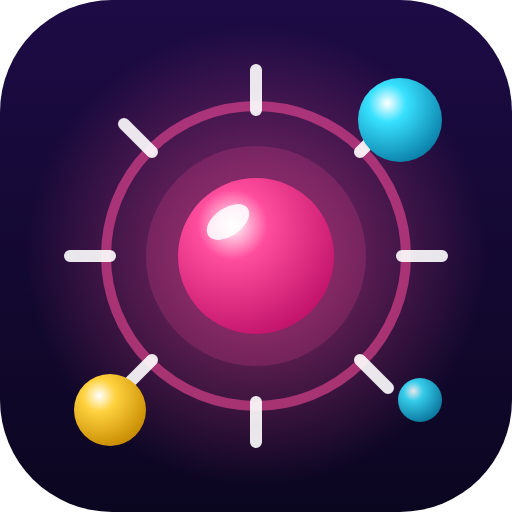
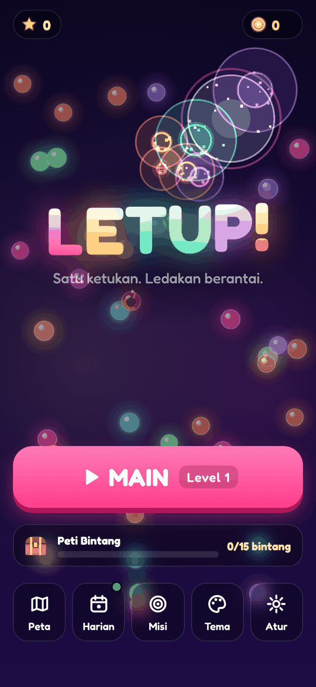
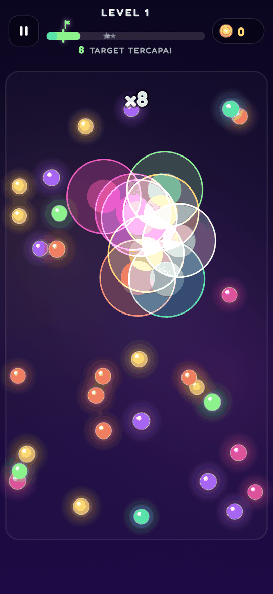
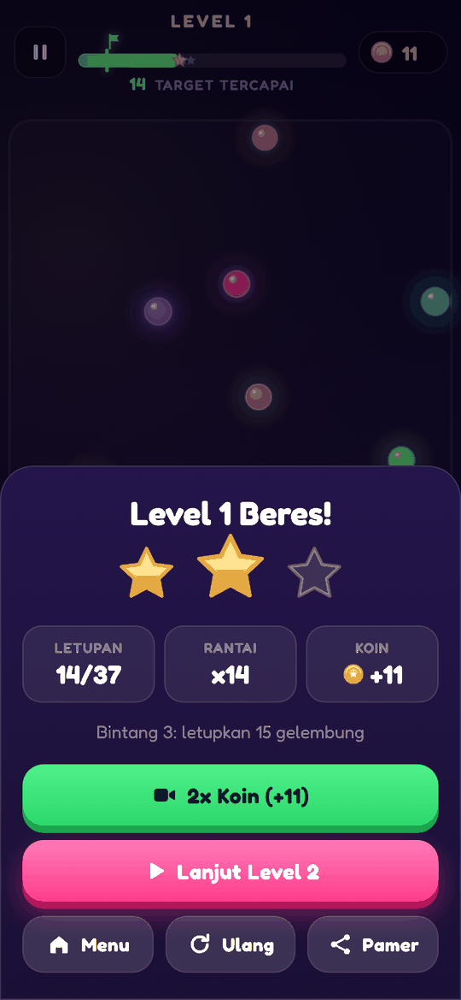
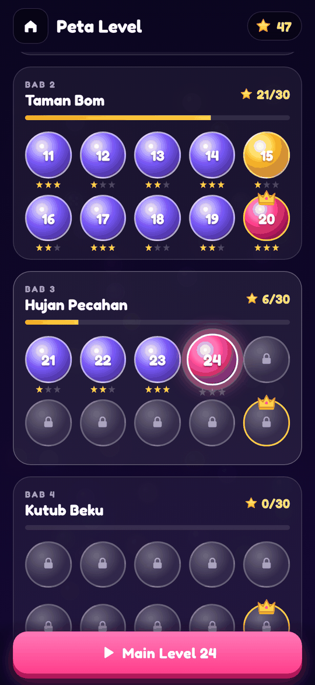
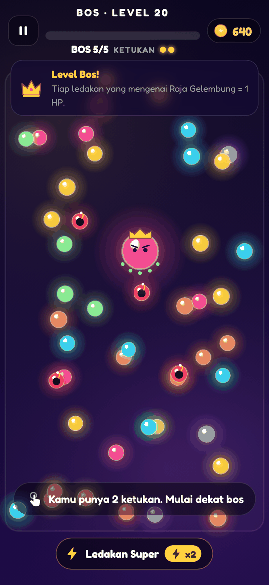
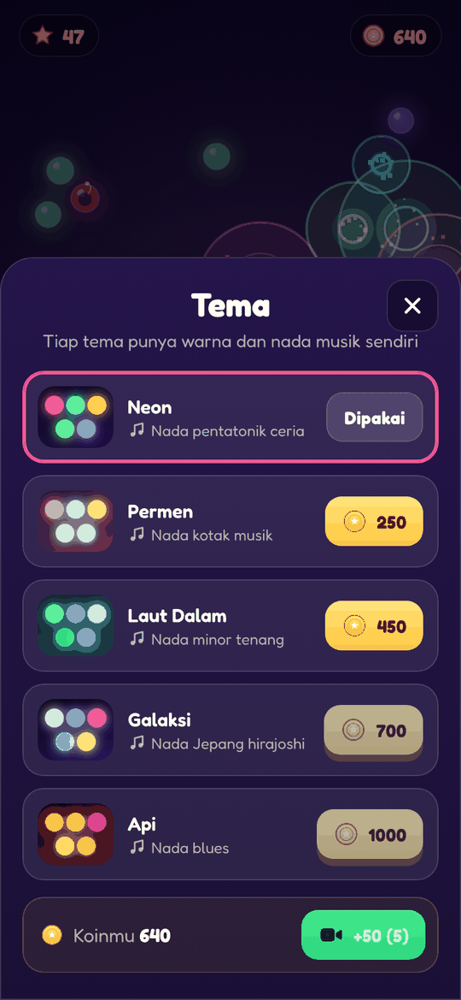

<div align="center">



# LETUP!

**Satu ketukan. Ledakan berantai.**
Ketuk sekali, lihat gelembung meletup berantai, dan dengarkan setiap letupan menyusun melodi.

[](https://lav-studio-org.github.io/letup/)

[](https://github.com/Lav-Studio-Org/letup/actions/workflows/pages.yml)







</div>

## Cara main

1. Setiap level kamu hanya punya **1 ketukan**.
2. Ketuk di tengah kumpulan gelembung. Ledakan memecahkan gelembung yang tersentuh, dan gelembung itu ikut meledak.
3. Capai target letupan (bendera di bar atas) untuk menang. Letupkan lebih banyak untuk bintang 2 dan 3.
4. Setiap letupan memainkan satu nada, jadi rantai yang panjang terdengar seperti lagu.

## Fitur

- **200 level dalam 20 bab.** Bab baru terbuka dengan jumlah bintang tertentu.
- **Level Bonus** tiap level ke-5 dan **Level Bos** tiap level ke-10: kalahkan Raja Gelembung dengan 2 ketukan.
- **FEVER** saat rantai mencapai 15: semua ledakan jadi lebih besar.
- **7 gelembung spesial**: Bom, Pembelah, Es, Koin, Baja, Hantu, dan Magnet.
- **Tantangan Harian**: papan yang sama untuk semua pemain, kejar skor dan jaga hari beruntun.
- **Misi harian, Peti Bintang** tiap 15 bintang, **hadiah login 7 hari**, dan stok **Ledakan Super**.
- **5 tema**, masing-masing dengan warna dan tangga nada sendiri (pentatonik, kotak musik, minor, Jepang, blues).
- Target tiap level dihitung lewat **simulasi ribuan ketukan**, jadi tingkat kesulitannya naik dengan mulus.
- **PWA**: bisa dipasang di layar utama dan dimainkan offline.

<div align="center">


</div>

## Teknologi

HTML, CSS, dan JavaScript biasa. Tanpa build step, tanpa framework, tanpa library. Game digambar di `<canvas>` dengan dunia tetap 360 × 640 sehingga sama di semua ukuran layar.

| Path | Isi |
| --- | --- |
| `js/engine.js` | Simulasi murni tanpa DOM |
| `js/levels-data.js` | Target, ambang bintang, dan HP bos level 1–200 (dihasilkan `scripts/gen-levels.js`) |
| `js/render.js` | Canvas: glow, partikel, gelombang kejut, teks, getar layar |
| `js/audio.js` | Suara sintetis Web Audio, tiap tema punya tangga nada sendiri |
| `js/meta.js` | Profil, koin, tema, misi harian, tantangan harian |
| `js/ads.js` | Lapisan iklan (contoh di web) |
| `js/main.js` | Alur game dan UI |
| `docs/` | Desain level, audit UI/UX, screenshot |

### Iklan (siap untuk versi APK)

Placement berhadiah: `extra_tap` (+1 ketukan saat gagal), `double_coins`, `super_blast`, `daily_try`, `mission_double`, `free_coins`, `chest_double`, `login_double`.
Interstitial hanya `level_end` dan dibatasi: tidak muncul di 6 hasil pertama, paling sering tiap 3 hasil level, jeda minimal 90 detik.
Aplikasi native cukup mengisi `LP.nativeAdProvider`.

## Jalankan lokal

```sh
git clone https://github.com/Lav-Studio-Org/letup.git
cd letup
python3 -m http.server 8123   # lalu buka http://localhost:8123/
```

### Skrip

```sh
node scripts/gen-levels.js 300    # hitung ulang target level lewat simulasi ketukan (±4 menit)
node scripts/audit-stars.js 100   # ukur peluang bintang 1/2/3 per bab
node scripts/smoke.js             # tes Playwright (butuh server di :8123)
node scripts/shots.js 390 844 m   # screenshot semua layar ke shots/audit
node scripts/icons.js             # render icon.svg ke PNG
```

Penjelasan desain level ada di [`docs/LEVEL_DESIGN.md`](docs/LEVEL_DESIGN.md).

## Deploy

Setiap push ke `main` disalin ke branch `gh-pages` oleh `.github/workflows/pages.yml`, lalu disajikan GitHub Pages di https://lav-studio-org.github.io/letup/. Naikkan `VERSION` di `sw.js` setiap rilis supaya pemain langsung dapat file baru.

## Lisensi aset

Font [Fredoka](https://fonts.google.com/specimen/Fredoka) (SIL Open Font License). Semua grafis dan suara dibuat khusus untuk game ini.
